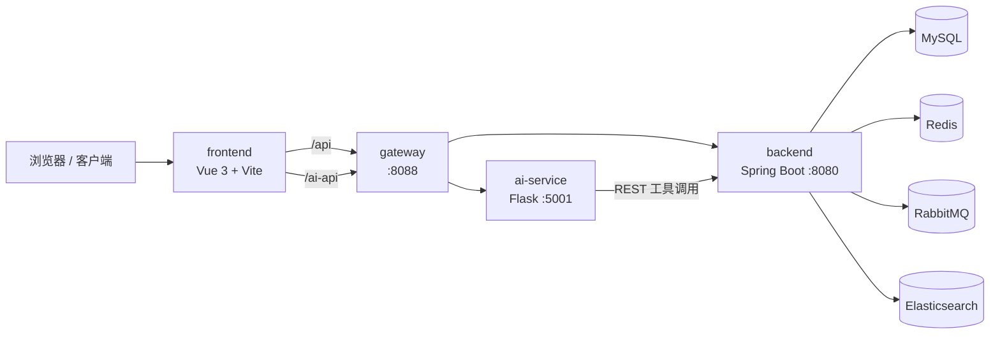

# RoomOS

面向民宿 / 酒店场景的全栈预订管理系统。覆盖房源与房型管理、订单与支付、优惠券与评价、后台运营、Elasticsearch 复合搜索，以及基于大模型的 AI 客服助手。

## 特性

- **完整预订链路**：用户注册登录、商家入驻、房源发布审核、下单、支付、入住退房
- **搜索能力**：关键词、城市、价格、评分、设施、精选与 LBS 附近搜索
- **消息与缓存**：RabbitMQ 异步事件、Redis 缓存与分布式锁
- **统一网关**：Spring Cloud Gateway 聚合业务 API 与 AI API
- **AI 客服助手**：Skill 路由、工具调用、写操作二次确认、流式对话
- **Copilot 界面**：独立 Vue 3 对话工作台，可嵌入主站或单独访问
- **一键部署**：Docker Compose 启动基础设施与核心服务

## 架构概览



默认 Docker 模式下，`ai-service` 在宿主机运行，网关通过 `host.docker.internal:5001` 转发 `/ai-api/**`。全量模式见下文。

## 技术栈

| 层级 | 技术 |
| --- | --- |
| 前端 | Vue 3、Vite、Vue Router、Pinia、Element Plus、Tailwind CSS |
| 业务后端 | Spring Boot 3.2、Spring Data JPA、Spring Cache、Redisson |
| 网关 | Spring Cloud Gateway |
| AI 服务 | Flask、Anthropic SDK、Skill / Tool 编排 |
| Copilot UI | Vue 3、TypeScript、Element Plus、Tailwind CSS |
| 数据与中间件 | MySQL 8.4、Redis 7、RabbitMQ 3.13、Elasticsearch 8.12 |
| 部署 | Docker、Docker Compose |

可选组件：Nacos 配置中心 / 服务发现（默认关闭）。

## 目录结构

```text
RoomOS/
├── frontend/                    # 主站前端（预订、商家、后台）
├── backend/                     # Spring Boot 业务后端
├── gateway/                     # API 网关
├── ai-service/                  # Flask AI 客服服务
│   ├── ui/                      # Copilot 对话界面源码
│   ├── skills/                  # Skill 定义与路由
│   ├── services/                # 聊天、工具、权限、会话
│   ├── tools/                   # 搜索、天气、地理编码等通用工具
│   └── tests/                   # pytest 测试
├── docs/                        # 部署与搜索等补充文档
├── scripts/                     # 辅助脚本
├── docker-compose.yml           # 默认一键部署（AI 服务本地运行）
├── docker-compose.full.yml      # 全量部署 overlay（含 AI 容器）
├── docker-compose.nacos.yml     # 单独启动 Nacos
└── docker-compose.elasticsearch.yml
```

## 环境要求

- **Docker 部署**：Docker 20+、Docker Compose v2
- **本地开发**：
  - JDK 17、Maven 3.9+
  - Node.js 18+
  - Python 3.12+
  - MySQL 8+、Redis、RabbitMQ、Elasticsearch（可用 Compose 单独拉起）

## 快速开始

### 1. 克隆仓库

```bash
git clone https://github.com/030203/AstraHost.git
cd AstraHost
```

### 2. 默认模式（推荐开发）

启动基础设施、后端、网关与前端；`ai-service` 在本地单独运行，便于调试与热更新。

```bash
docker compose up -d --build
```

另开终端启动 AI 服务：

```bash
cd ai-service
pip install -r requirements.txt

# 在 ai-service 目录创建 .env，至少配置大模型 Key（见下文）
python app.py
```

### 3. 全量 Docker 模式

若希望 AI 服务也容器化：

```bash
docker compose -f docker-compose.yml -f docker-compose.full.yml up -d --build
```

### 4. 访问地址

| 服务 | 地址 |
| --- | --- |
| 前端 | http://localhost |
| 前端开发模式 | http://localhost:5400 |
| 网关 | http://localhost:8088 |
| 后端健康检查 | http://localhost:8080/api/actuator/health |
| AI 健康检查 | http://localhost:5001/health |
| AI Copilot | http://localhost:5001/ |
| RabbitMQ 控制台 | http://localhost:15672 |
| Elasticsearch | http://localhost:9200 |

### 5. 常用命令

```bash
# 查看日志
docker compose logs -f

# 停止服务
docker compose down

# 停止并删除数据卷（会清空数据库）
docker compose down -v
```

更多说明见 [docs/docker-one-click.md](docs/docker-one-click.md)。

## 本地开发

按以下顺序启动各模块。

### 1. 基础设施

可使用项目内 Compose 文件单独启动：

```bash
docker compose -f docker-compose.elasticsearch.yml up -d
# 可选：docker compose -f docker-compose.nacos.yml up -d
```

或自行安装 MySQL、Redis、RabbitMQ、Elasticsearch。

### 2. 业务后端

```bash
cd backend
mvn spring-boot:run
```

配置见 [backend/src/main/resources/application.properties](backend/src/main/resources/application.properties)。

### 3. 网关

```bash
cd gateway
mvn spring-boot:run
```

默认端口 `8088`，配置见 [gateway/src/main/resources/application.yml](gateway/src/main/resources/application.yml)。

### 4. 主站前端

```bash
cd frontend
npm install
npm run dev
```

开发模式下，Vite 将 `/api`、`/ai-api` 代理到 `http://localhost:8088`，部分 AI 路径直连 `http://localhost:5001`。

### 5. AI 服务与 Copilot UI

```bash
# AI 后端
cd ai-service
pip install -r requirements.txt
python app.py

# Copilot 前端（可选，开发态）
cd ai-service/ui
npm install
npm run dev
```

构建 Copilot 静态资源并嵌入 Flask：

```bash
cd ai-service/ui
npm run build
# 产物输出到 ai-service/static/copilot/
```

## 配置说明

### 数据库默认值

Docker Compose 首次启动会自动执行 [docs/booking_system.sql](docs/booking_system.sql) 初始化数据库。

| 项 | 默认值 |
| --- | --- |
| 数据库名 | `booking_system` |
| 用户名 | `root` |
| 密码 | `456456` |
| MySQL 端口 | `3306` |
| Redis 端口（Docker 映射） | `6380` → 容器内 `6379` |

> 上线或公开部署前，请务必修改默认密码，并通过环境变量覆盖敏感配置。

### AI 服务环境变量

在 `ai-service/.env` 中配置（可参考下列常用项）：

```env
# 服务
AI_SERVICE_HOST=0.0.0.0
AI_SERVICE_PORT=5001
BOOKING_SERVICE_BASE_URL=http://127.0.0.1:8080/api

# 大模型（必填之一，否则只能启动但无法正常对话）
ANTHROPIC_API_KEY=your_key
ANTHROPIC_MODEL=claude-3-5-sonnet-latest

# 可选：意图路由（小米 Mimo 等）
# XIAOMI_API_KEY=
# XIAOMI_BASE_URL=https://api.xiaomimimo.com/v1

# 可选：外部工具
# TAVILY_API_KEY=
# OPENWEATHER_API_KEY=

# 会话
CONVERSATION_TTL_SECONDS=86400
CONVERSATION_MAX_MESSAGES=20
ALLOW_MOCK_USER_CONTEXT=true
```

未配置 `ANTHROPIC_API_KEY` 时服务仍可启动，但对话能力不可用。

### 网关路由

| 前缀 | 目标 |
| --- | --- |
| `/api/**` | 业务后端 |
| `/ai-api/**` | AI 服务（去掉前缀后转发） |

主要业务分组：`/api/auth`、`/api/properties`、`/api/bookings`、`/api/payments`、`/api/reviews` 等。

AI 接口示例：

```http
GET  /ai-api/suggestions
POST /ai-api/chat
POST /ai-api/chat/stream
GET  /ai-api/skills
POST /ai-api/skills/route
GET  /ai-api/health
```

## AI 客服能力

AI 服务通过 REST 调用后端 API，不直接读写业务数据库。核心能力包括：

- **Skill 路由**：按用户意图选择客服 Skill 与工具集
- **领域工具**：房源、房型、订单、支付、评价、通知、优惠券、商家、用户等查询与操作
- **通用工具**：网页搜索（Tavily）、天气、时间、地理编码
- **安全机制**：基于角色的工具访问策略；写操作需二次确认
- **会话管理**：多轮对话上下文与本地 / 文件持久化
- **流式输出**：`POST /chat/stream` 支持 SSE

Agent 开发规范见 [ai-service/AGENTS.md](ai-service/AGENTS.md)。

## Elasticsearch 搜索

支持关键词、城市、价格区间、评分、设施、精选与附近房源搜索。

```http
GET  /api/properties/search
POST /api/properties/search/reindex
```

首次启用 ES 后建议执行一次全量重建：

```bash
curl -X POST http://localhost:8080/api/properties/search/reindex
```

详细说明见 [docs/elasticsearch-search.md](docs/elasticsearch-search.md)。

## 测试

```bash
# 后端
cd backend && mvn test

# AI 服务
cd ai-service && python -m pytest tests/
```

## 补充文档

| 文档 | 说明 |
| --- | --- |
| [docs/docker-one-click.md](docs/docker-one-click.md) | Docker 部署详解 |
| [docs/elasticsearch-search.md](docs/elasticsearch-search.md) | 搜索与索引 |
| [docs/nacos-setup.md](docs/nacos-setup.md) | Nacos 可选配置 |
| [ai-service/docs/README.md](ai-service/docs/README.md) | AI 服务开发文档索引 |

## 常见问题

**Docker 拉镜像失败**

多为 Docker Hub 网络问题。可配置镜像加速，或通过 `MAVEN_BUILD_IMAGE`、`NODE_BUILD_IMAGE` 等环境变量指向可访问的基础镜像源后再构建。详见 [docs/docker-one-click.md](docs/docker-one-click.md)。

**后端启动失败**

确认 MySQL、Redis、RabbitMQ、Elasticsearch 已就绪，并检查 `application.properties` 或 Compose 环境变量。

**搜索无结果**

确认 `ROOMOS_ES_ENABLED=true` 且 ES 地址正确，然后执行索引重建。

**AI 可访问但无法对话**

通常是未配置 `ANTHROPIC_API_KEY`。网关需能访问 AI 服务（默认模式为宿主机 `5001` 端口）。

**网关找不到 AI 服务**

默认模式依赖 `host.docker.internal`。若本机 Docker 不支持，可改用全量 Compose 模式，或设置 `AI_SERVICE_URL` 环境变量。

## License

本项目尚未声明开源许可证。如需公开托管，建议补充 `LICENSE` 文件（例如 MIT / Apache-2.0）。
