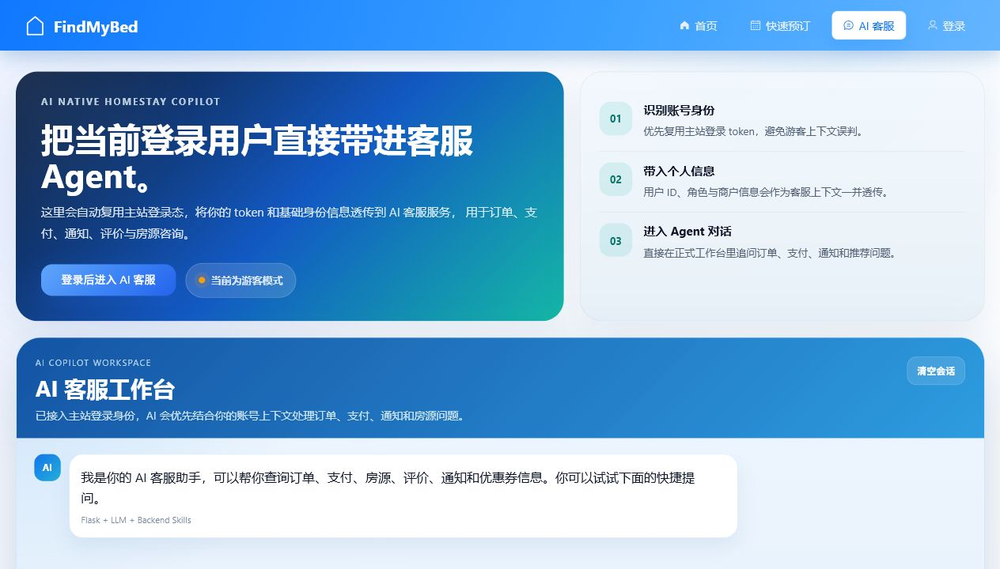
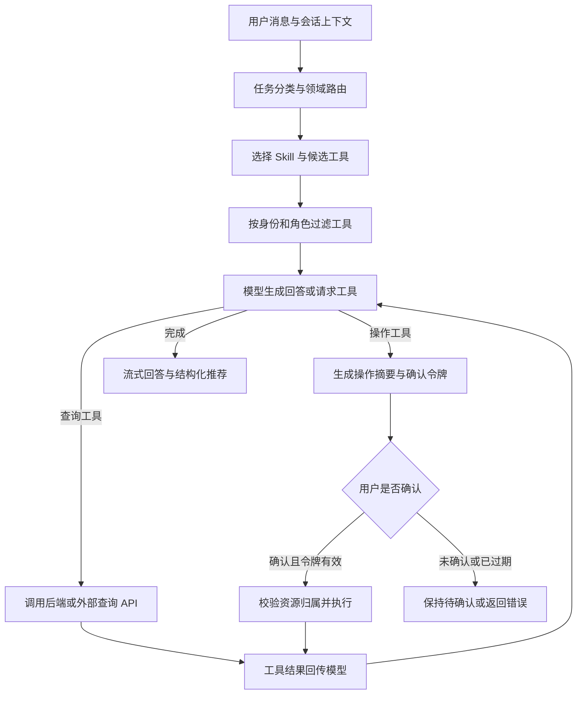
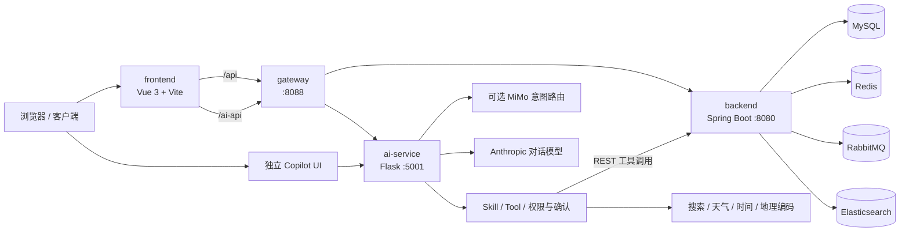

# AstraHost · RoomOS

**面向民宿与酒店的全栈预订平台，内置可调用真实业务工具的 AI 客服 Agent。**

AstraHost（项目目录与服务配置沿用 RoomOS）将住宿预订、商家运营和 AI 智能管家整合在同一个系统中。用户可以浏览房源、筛选房型、管理订单与支付，也可以通过自然语言查询业务数据、获取住宿推荐，并在确认后完成预订、取消订单等操作。

项目由 Vue 3 主站、Spring Boot 业务后端、Spring Cloud Gateway 和 Flask AI 服务组成，适合用于学习全栈预订业务、领域工具编排、Agent 权限控制和流式交互。

[项目预览](#项目预览) · [业务功能](#业务功能) · [Agent 能力](#agent-能力) · [架构概览](#架构概览) · [快速开始](#快速开始) · [接口说明](#接口说明) · [补充文档](#补充文档)

## 项目预览

### 首页主视觉


主站首页使用的民宿场景素材，原文件保存在 `frontend/src/assets/generated/`。

### AI 客服界面



仓库保留的早期 AI 客服截图，展示主站登录身份接入与客服工作台。图中品牌和布局属于历史版本；当前主站对话入口为 `/assistant`，独立 Copilot 界面保留在 `ai-service/ui/`。

## 特性

- **完整预订链路**：用户注册登录、商家入驻、房源发布审核、下单、支付、入住退房
- **搜索能力**：关键词、城市、价格、评分、设施、精选与 LBS 附近搜索
- **消息与缓存**：RabbitMQ 异步事件、Redis 缓存与分布式锁
- **统一网关**：Spring Cloud Gateway 聚合业务 API 与 AI API
- **业务 Agent**：双层意图路由、8 类领域 Skill、模型与工具多步交互
- **可确认的业务操作**：创建预订、取消订单、支付处理等写操作先生成确认摘要，再执行
- **流式工作台**：SSE 增量回答、结构化房源卡片、历史会话；独立 Copilot 提供工具执行轨迹
- **身份与权限**：复用主站登录上下文，按用户、商家、管理员角色过滤工具并校验资源归属
- **一键部署**：Docker Compose 启动基础设施与核心服务

## 业务功能

| 场景 | 主要能力 |
| --- | --- |
| 住客预订 | 注册登录、房源浏览、房型详情、快速预订、订单查询、待支付订单与支付记录 |
| 房源发现 | 关键词、城市、价格区间、评分、设施、精选房源与经纬度附近搜索 |
| 商家运营 | 商家入驻、房源与房型管理、商家订单、入住退房与评价回复 |
| 平台管理 | 房源审核、用户与商家管理、订单运营、统计页面 |
| 用户服务 | 个人资料、优惠券、评价、通知与未读状态 |
| AI 智能管家 | 住宿推荐、业务查询、确认式业务操作、天气与出行信息辅助 |

## Agent 能力

Agent 的业务数据来自后端 REST API。模型负责理解问题、选择工具和组织回答，业务读写由 `ToolService` 与后端接口完成。主对话模型通过 Anthropic SDK 接入，可选的 Xiaomi MiMo 模型负责意图分类。

### 双层意图路由与 Skill 编排

配置 MiMo 路由后，系统先区分 **Business（执行操作） / Query（查询信息） / Content（生成文案） / Chat（闲聊）**，再为业务与查询任务识别 **Property / Booking / Payment / Review / User** 领域，选择对应 Skill、提示词和工具集合。

未配置路由模型或模型调用失败时，回退到关键词匹配。路由结果还会经过角色权限过滤；天气、时间、位置与外部搜索工具按问题提示补充。没有命中领域时，回退工具集合限制为房源搜索、热门房源及通用查询等低风险工具。

领域 Skill 定义在 [customer_service.py](ai-service/skills/customer_service.py)：

| Skill | 业务范围 | 代表工具 |
| --- | --- | --- |
| `property_support` | 房源、房型、设施、价格与位置 | `search_properties`、`get_property_detail`、`list_room_types` |
| `booking_support` | 预订查询、创建、取消、入住与退房 | `get_booking_by_number`、`create_booking`、`cancel_booking` |
| `payment_support` | 支付状态、支付记录与支付处理 | `get_payment_by_number`、`create_payment`、`process_payment` |
| `review_support` | 评价查询与商家回复 | `get_review_by_booking`、`reply_review` |
| `notification_support` | 通知、未读数量与已读状态 | `list_notifications`、`mark_notification_read` |
| `coupon_support` | 优惠券详情与适用信息 | `list_coupons`、`get_coupon_detail` |
| `merchant_support` | 商家信息与用户关联 | `get_merchant_detail`、`get_merchant_by_user` |
| `user_support` | 用户与账户信息 | `get_user_detail`、`list_users` |

通用工具包括 Tavily 网页搜索、OpenWeather 天气、当前时间与时区查询、地理编码。外部搜索与天气需要配置对应服务的 API Key。

MiMo 路由支持逗号分隔的多 Key 池、轮询与 429 冷却重试。相关实现见 [intent_router.py](ai-service/services/intent_router.py) 和 [skill_service.py](ai-service/services/skill_service.py)。

### 模型与工具的多步执行

`ChatService` 将当前消息、历史上下文和领域提示词交给模型，执行模型请求的工具，再把工具结果送回模型，直到生成回答或达到调用步数上限。默认最多执行 6 轮，可通过 `TOOL_CALL_MAX_STEPS` 调整。



### 写操作二次确认

Agent 已接入以下操作工具：

- **订单**：创建预订、取消订单、办理入住、办理退房。
- **支付**：创建支付单、处理支付结果。
- **评价**：回复评价。
- **通知**：标记单条通知或全部通知为已读。

第一次调用操作工具时，服务返回 `pendingAction`，包含操作对象、影响说明、确认文本与过期时间。用户在界面点击“确认执行”或按要求提交确认文本后，服务再校验确认令牌、工具名、参数和用户身份，并执行操作。令牌默认 300 秒过期，使用后失效。

普通用户、商家和管理员拥有不同工具权限。订单、支付、评价回复和通知等资源由对应处理器校验归属。具体规则见 [tool_access_policy.py](ai-service/services/tool_access_policy.py) 与 [action_confirmation_service.py](ai-service/services/action_confirmation_service.py)。

> 当前身份接入采用开发用 `Bearer dev-token-<userId>`，并可启用 mock 用户上下文。该实现用于开发演示，生产接入需要替换为可信的身份认证；仅关闭 mock 开关并不能完成生产鉴权。支付工具调用项目内支付业务接口，实际收款能力取决于支付渠道接入。当前没有独立退款工具。

### 流式交互与可见的执行过程

- **SSE 增量输出**：`/chat/stream` 传递回答片段、执行状态、工具事件和最终结果。
- **执行轨迹**：独立 Copilot UI 展示“理解需求 → 调用工具 → 等待确认 → 生成结果”，以及工具名称、结果摘要与成功 / 失败状态。
- **结构化推荐**：房源工具结果可整理为 `recommendations`，在界面中展示酒店卡片并跳转房源详情。
- **请求追踪**：请求和响应携带 `X-Request-ID`，便于关联 AI 服务与后端工具调用日志。

### 多轮对话与历史会话

服务端以 `conversationId` 管理对话，支持历史消息读取、JSON 文件持久化、过期清理和消息数量裁剪。默认会话有效期为 24 小时，最多保留最近 20 条消息；存储路径可通过 `CONVERSATION_STORE_PATH` 调整。

主站工作台还通过浏览器本地存储保存会话标题、消息、推荐结果与待确认操作，支持新建、切换、收藏和删除本地历史会话。前端删除历史记录不会同步删除服务端会话。

### 可以这样体验

以下问题用于演示交互方式；查询结果来自实际后端数据，操作能否执行取决于当前身份、资源状态和用户确认。

| 示例问题 | 对应能力 |
| --- | --- |
| “帮我找杭州每晚 500 元以内、评分较高的酒店。” | 房源搜索、条件筛选、结构化推荐 |
| “查看我最近的订单，确认一下入住日期。” | 登录用户订单查询与详情读取 |
| “帮我取消这笔预订。” | 订单查询、取消摘要、二次确认 |
| “这笔订单的支付成功了吗？” | 支付记录与支付状态查询 |
| “我是商家，帮我回复这条评价。” | 商家权限、评价查询、回复确认 |
| “把我的通知标记为已读。” | 通知归属校验与确认式状态更新 |
| “查一下杭州天气，再搜索西湖周边游玩攻略。” | 天气查询与外部网页搜索 |

## 架构概览



默认 Docker 模式下，`ai-service` 在宿主机运行，网关通过 `host.docker.internal:5001` 转发 `/ai-api/**`。全量模式见下文。

## 技术栈

| 层级 | 技术 |
| --- | --- |
| 前端 | Vue 3、Vite、Vue Router、Pinia、Element Plus、Tailwind CSS |
| 业务后端 | Spring Boot 3.2、Spring Data JPA、Spring Cache、Redisson |
| 网关 | Spring Cloud Gateway |
| AI 服务 | Flask、Anthropic SDK、可选 Xiaomi MiMo 意图路由、Skill / Tool 编排、SSE |
| Copilot UI | Vue 3、TypeScript、Element Plus、Tailwind CSS |
| 数据与中间件 | MySQL 8.4、Redis 7、RabbitMQ 3.13、Elasticsearch 8.12 |
| 部署 | Docker、Docker Compose |

可选组件：Nacos 配置中心 / 服务发现（默认关闭）。

## 目录结构

```text
RoomOS/
├── frontend/                    # 主站前端（预订、商家、后台）
├── backend/                     # Spring Boot 业务后端
├── gateway/                     # API 网关
├── ai-service/                  # Flask AI 客服服务
│   ├── ui/                      # Copilot 对话界面源码
│   ├── skills/                  # Skill 定义与路由
│   ├── services/                # 聊天、意图路由、工具、权限、操作确认、会话
│   ├── tools/                   # 搜索、天气、地理编码等通用工具
│   ├── docs/                    # Agent 技术、设计规范与实施计划
│   ├── dev-logs/                # 开发与验证记录
│   └── tests/                   # pytest 测试
├── docs/                        # 部署与搜索等补充文档
├── scripts/                     # 辅助脚本
├── docker-compose.yml           # 默认一键部署（AI 服务本地运行）
├── docker-compose.full.yml      # 全量部署 overlay（含 AI 容器）
├── docker-compose.nacos.yml     # 单独启动 Nacos
└── docker-compose.elasticsearch.yml
```

## 环境要求

- **Docker 部署**：Docker 20+、Docker Compose v2
- **本地开发**：
  - JDK 17、Maven 3.9+
  - 主站使用 Node.js 18+；独立 Copilot UI 使用 Node.js 20.19+ 或 22.12+（Vite 7）
  - Python 3.12+
  - MySQL 8+、Redis、RabbitMQ、Elasticsearch（可用 Compose 单独拉起）

## 快速开始

### 1. 克隆仓库

```bash
git clone https://github.com/030203/AstraHost.git
cd AstraHost
```

### 2. 默认模式（推荐开发）

启动基础设施、后端、网关与前端；`ai-service` 在本地单独运行，便于调试与热更新。

先复制 AI 服务配置并填写自己的模型 Key：

```bash
cp ai-service/.env.example ai-service/.env
# Windows PowerShell：Copy-Item ai-service/.env.example ai-service/.env
```

编辑 `ai-service/.env` 中的 `ANTHROPIC_API_KEY`，并将 `ANTHROPIC_MODEL` 设置为该 Key 可用的模型。未配置 MiMo Key 时仍可使用关键词路由。

```bash
docker compose up -d --build
```

另开终端启动 AI 服务：

```bash
cd ai-service
pip install -r requirements.txt

python app.py
```

### 3. 全量 Docker 模式

若希望 AI 服务也容器化，先完成上述 `.env` 配置，并将其中的 `BOOKING_SERVICE_BASE_URL` 改为 `http://backend:8080/api`，使 AI 容器通过 Compose 服务名访问业务后端：

```bash
docker compose -f docker-compose.yml -f docker-compose.full.yml up -d --build
```

当前 AI Dockerfile 会复制整个服务目录，包含本地 `.env`。此方式用于本地演示；不要发布包含凭据的镜像，部署时应改为运行时注入配置。

### 4. 访问地址

| 服务 | 地址 |
| --- | --- |
| 前端 | http://localhost |
| 主站 AI 工作台（需登录） | http://localhost/assistant |
| 前端开发模式 | http://localhost:5400 |
| 开发模式 AI 工作台（需登录） | http://localhost:5400/assistant |
| 网关 | http://localhost:8088 |
| 后端健康检查 | http://localhost:8080/api/actuator/health |
| AI 健康检查 | http://localhost:5001/health |
| AI Copilot | http://localhost:5001/ |
| 独立 Copilot 开发模式 | http://localhost:5100/static/copilot/ |
| RabbitMQ 控制台 | http://localhost:15672 |
| Elasticsearch | http://localhost:9200 |

### 5. 常用命令

```bash
# 查看日志
docker compose logs -f

# 停止服务
docker compose down

# 停止并删除数据卷（会清空数据库）
docker compose down -v
```

更多说明见 [docs/docker-one-click.md](docs/docker-one-click.md)。

## 本地开发

按以下顺序启动各模块。

### 1. 基础设施

可直接使用默认 Compose 文件启动四个基础设施服务：

```bash
docker compose up -d mysql redis rabbitmq elasticsearch
# 可选：docker compose -f docker-compose.nacos.yml up -d
```

或自行安装 MySQL、Redis、RabbitMQ、Elasticsearch。注意 Compose 将 Redis 映射到宿主机 `6380` 端口；本地后端应设置 `ROOMOS_REDIS_PORT=6380`，或使用与实际实例一致的配置。

### 2. 业务后端

```bash
cd backend
mvn spring-boot:run
```

配置见 [backend/src/main/resources/application.properties](backend/src/main/resources/application.properties)。

### 3. 网关

```bash
cd gateway
mvn spring-boot:run
```

默认端口 `8088`，配置见 [gateway/src/main/resources/application.yml](gateway/src/main/resources/application.yml)。

### 4. 主站前端

```bash
cd frontend
npm install
npm run dev
```

开发模式下，Vite 将 `/api`、`/ai-api` 代理到 `http://localhost:8088`，部分 AI 路径直连 `http://localhost:5001`。

### 5. AI 服务与 Copilot UI

先按快速开始创建 `ai-service/.env`，确认本地 `BOOKING_SERVICE_BASE_URL=http://127.0.0.1:8080/api`。

```bash
# AI 后端
cd ai-service
pip install -r requirements.txt
python app.py
```

另开终端，从仓库根目录启动独立 Copilot UI（可选）：

```bash
cd ai-service/ui
npm install
npm run dev
```

构建 Copilot 静态资源并嵌入 Flask：

```bash
cd ai-service/ui
npm run build
# 产物输出到 ai-service/static/copilot/
```

## 配置说明

### 数据库默认值

Docker Compose 首次启动会自动执行 [docs/booking_system.sql](docs/booking_system.sql) 初始化数据库。

| 项 | 默认值 |
| --- | --- |
| 数据库名 | `booking_system` |
| 用户名 | `root` |
| 密码 | `456456` |
| MySQL 端口 | `3306` |
| Redis 端口（Docker 映射） | `6380` → 容器内 `6379` |

> 上线或公开部署前，请务必修改默认密码，并通过环境变量覆盖敏感配置。

### AI 服务环境变量

以 [ai-service/.env.example](ai-service/.env.example) 为模板创建 `ai-service/.env`。常用项如下，模型名称为仓库示例值，需按自己的模型账户调整：

```env
# 服务
AI_SERVICE_HOST=0.0.0.0
AI_SERVICE_PORT=5001
BOOKING_SERVICE_BASE_URL=http://127.0.0.1:8080/api

# 对话模型（Key 必填，否则只能启动但无法正常对话）
ANTHROPIC_BASE_URL=https://api.anthropic.com
ANTHROPIC_API_KEY=your_key
ANTHROPIC_MODEL=claude-3-5-sonnet-latest

# 可选：MiMo 意图路由，不配置则使用关键词路由
# XIAOMI_API_KEYS=your_router_key_1,your_router_key_2
# XIAOMI_BASE_URL=https://api.xiaomimimo.com/v1
# XIAOMI_MODEL=mimo-v2-flash

# 可选：外部工具
# TAVILY_API_KEY=
# OPENWEATHER_API_KEY=

# 会话
CONVERSATION_TTL_SECONDS=86400
CONVERSATION_MAX_MESSAGES=20
# CONVERSATION_STORE_PATH=./data/conversations.json

# 工具编排与操作确认
TOOL_CALL_MAX_STEPS=6
ACTION_CONFIRMATION_TTL_SECONDS=300

# 仅用于本地开发的模拟身份
ALLOW_MOCK_USER_CONTEXT=true
```

未配置 `ANTHROPIC_API_KEY` 时服务仍可启动，但对话能力不可用。

## 接口说明

### 网关路由

| 前缀 | 目标 |
| --- | --- |
| `/api/**` | 业务后端 |
| `/ai-api/**` | AI 服务（去掉前缀后转发） |

主要业务分组：`/api/auth`、`/api/properties`、`/api/bookings`、`/api/payments`、`/api/reviews` 等。

### AI 接口

下列路径经网关访问；直连 Flask `:5001` 时去掉 `/ai-api` 前缀。

| 方法 | 路径 | 用途 |
| --- | --- | --- |
| `GET` | `/ai-api/health` | AI 服务健康检查 |
| `GET` | `/ai-api/suggestions` | 获取推荐提问 |
| `GET` | `/ai-api/skills` | 查看领域 Skill、关键词与工具定义 |
| `POST` | `/ai-api/skills/route` | 预览消息对应的 Skill 与工具路由 |
| `POST` | `/ai-api/chat` | 普通对话 |
| `POST` | `/ai-api/chat/stream` | SSE 流式对话 |
| `GET` | `/ai-api/conversations` | 获取有效会话 ID 列表 |
| `GET` | `/ai-api/conversations/{conversationId}/messages` | 读取会话历史消息 |

以公开房源查询为例：

```bash
curl -N http://localhost:8088/ai-api/chat/stream \
  -H "Content-Type: application/json" \
  -d '{"message":"帮我查找杭州的酒店","conversationId":"readme-demo"}'
```

`/chat` 与 `/chat/stream` 的请求支持 `message`、`conversationId`、开发态 `userContext` 和确认操作用的 `pendingAction`。登录身份通过 `Authorization` 请求头传递。

普通对话返回 `answer`、`route`、`recommendations`、`pendingAction` 与 `requestId` 等字段；流式接口以 `data: {JSON}` 格式传递事件：

| 事件 | 内容 |
| --- | --- |
| `meta` | 会话 ID、路由信息与请求 ID |
| `status` | 当前执行阶段与提示文字 |
| `chunk` | 增量回答文本 |
| `tool_start` / `tool_end` | 工具调用名称、状态与结果摘要 |
| `done` | 完整回答、推荐卡片与待确认操作 |
| `error` | 请求或执行错误 |

需要确认时，将服务返回的 `pendingAction` 原样回传，并将 `message` 设为其中的 `confirmation_text`。确认令牌校验失败或过期时，操作不会执行。

## Elasticsearch 搜索

支持关键词、城市、价格区间、评分、设施、精选与附近房源搜索。

```http
GET  /api/properties/search
POST /api/properties/search/reindex
```

首次启用 ES 后建议执行一次全量重建：

```bash
curl -X POST http://localhost:8080/api/properties/search/reindex
```

详细说明见 [docs/elasticsearch-search.md](docs/elasticsearch-search.md)。

## 测试

以下命令分别从仓库根目录执行。

```bash
# 后端
cd backend
mvn test
```

```bash
# AI 服务
cd ai-service
python -m pip install pytest
python -m pytest tests/
```

Agent 测试覆盖工具权限、资源归属、操作确认、意图路由、会话持久化、聊天编排及 API 行为。测试使用 mock / fake 验证逻辑，真实模型和后端业务仍需按部署环境联调。

可使用现有评估脚本检查路由样本（在 `ai-service` 目录执行）：

```bash
# 关键词路由
python tools/evaluate_skill_routing.py

# 模型路由，需要配置 MiMo Key，会调用外部模型
python tools/evaluate_skill_routing.py --llm
```

## 扩展 Agent

1. 在 [ToolService](ai-service/services/tool_service.py) 注册工具名称、说明、参数 Schema 与允许角色；业务请求统一通过 [BackendAPIService](ai-service/services/backend_api_service.py) 封装。
2. 在领域处理器与权限策略中补齐资源归属校验；写操作标记为 `action`，接入待确认摘要与确认令牌流程。
3. 在 [领域 Skill](ai-service/skills/customer_service.py) 和 [意图路由资源映射](ai-service/services/intent_router.py) 中配置工具与提示词。
4. 补充成功、无权限、参数错误、确认过期等测试，并更新路由样本和开发记录。

开发约束与模块边界见 [ai-service/AGENTS.md](ai-service/AGENTS.md)、[技术规范](ai-service/docs/technical-standards.md) 和 [设计规范](ai-service/docs/design-standards.md)。优化方案中的待办不代表当前已实现的功能。

## 补充文档

| 文档 | 说明 |
| --- | --- |
| [docs/docker-one-click.md](docs/docker-one-click.md) | Docker 部署详解 |
| [docs/elasticsearch-search.md](docs/elasticsearch-search.md) | 搜索与索引 |
| [docs/nacos-setup.md](docs/nacos-setup.md) | Nacos 可选配置 |
| [ai-service/docs/README.md](ai-service/docs/README.md) | AI 服务开发文档索引 |
| [Agent 技术规范](ai-service/docs/technical-standards.md) | 模块边界、接口和测试要求 |
| [Agent 设计规范](ai-service/docs/design-standards.md) | 客服行为、工具使用与操作确认 |
| [Agent 优化方案](ai-service/docs/customer-service-agent-optimization-plan.md) | 阶段目标与后续规划 |
| [Copilot UI 设计系统](ai-service/docs/copilot-ui-design-system.md) | 工作台视觉与交互规范 |
| [开发日志](ai-service/dev-logs/README.md) | 功能演进与验证记录 |

## 常见问题

**Docker 拉镜像失败**

多为 Docker Hub 网络问题。可配置镜像加速，或通过 `MAVEN_BUILD_IMAGE`、`NODE_BUILD_IMAGE` 等环境变量指向可访问的基础镜像源后再构建。详见 [docs/docker-one-click.md](docs/docker-one-click.md)。

**后端启动失败**

确认 MySQL、Redis、RabbitMQ、Elasticsearch 已就绪，并检查 `application.properties` 或 Compose 环境变量。

**搜索无结果**

确认 `ROOMOS_ES_ENABLED=true` 且 ES 地址正确，然后执行索引重建。

**AI 可访问但无法对话**

检查 `ANTHROPIC_API_KEY`、`ANTHROPIC_BASE_URL`、模型名称与模型服务连通性。`/health` 成功仅说明 Flask 进程可访问，不代表模型或业务后端已可用。

**未配置 MiMo，Agent 还能使用吗？**

可以。MiMo 仅用于可选的双层意图分类；未配置时使用关键词路由。对话模型仍需要 Anthropic 配置。

**Agent 提示需要登录或没有权限**

先登录主站，再从 `/assistant` 进入工作台。查询个人订单、支付、通知以及执行业务操作都受角色与资源归属限制。

**点击确认后提示令牌无效**

确认令牌默认 5 分钟有效，且绑定用户、工具与参数并只能使用一次。重新发起操作以生成新的确认摘要；服务重启也会清除内存中的待确认令牌。

**网关找不到 AI 服务**

默认模式依赖 `host.docker.internal`。若本机 Docker 不支持，可改用全量 Compose 模式，或设置 `AI_SERVICE_URL` 环境变量。

## License

本项目当前尚未声明开源许可证，仓库中未包含 `LICENSE` 文件。
